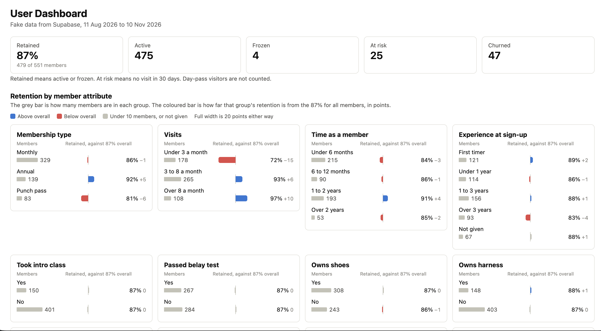

# RetentionApp

A dashboard that helps climbing gym owners see **who is staying, who is
slipping away, and what the members who leave have in common.**



Gyms live on memberships, and most people who cancel go quiet first. This
app turns check-in history into a retention picture an owner can act on.

## What it does

- Sorts every member into **active, frozen, at risk or churned** from their
  visit history. No visit in 30 days puts a member at risk. Pass holders
  count as churned after 60 days.
- Shows the retention rate for **each member attribute**: membership type,
  visits per month, time as a member, project grade, age, height and
  postal area.
- Keeps day-pass visitors out of the numbers, since they never held a
  membership to retain.

## Tech

React 19, TypeScript, Vite and Supabase (Postgres), with Vitest for tests
and oxlint for linting.

Some choices worth a look:

- **The retention rules are plain functions** in `src/retention/`, separate
  from the UI, and covered by tests (`npm test`).
- **The data source is swappable.** The app runs on generated data in code
  with no setup, or on the same data loaded from Supabase. Set
  `VITE_DATA_SOURCE` to `code` or `supabase`.
- **The schema is versioned.** Migrations and seed data live in
  `supabase/`. Tables use row-level security: public read, no writes.
  That suits a demo of generated data. Real member records would need
  staff sign-in and per-gym rules.

## Status and next steps

This is a work in progress. Planned next:

- **At-risk member list.** Show the members who have gone quiet, with days
  since their last visit, so an owner knows who to reach out to.
- **Pattern finder across attributes.** Today each attribute is shown on its
  own. Mapping them against each other (for example, new members who visit
  under 3 times a month) would show combinations that predict churn.
- **Staff sign-in and per-gym access**, so the app could safely hold real
  member records instead of generated data.

## Run it

Requires Node 22.13 or newer.

```bash
npm install
npm run dev
```

That uses the generated data and needs no other setup. To read from
Supabase instead, see [docs/supabase.md](docs/supabase.md).

Other scripts: `npm test`, `npm run build`, `npm run lint`.

## About the data

No public dataset of climbing gym memberships and check-ins exists, so the
data is generated from a fixed seed in `src/data/mockData.ts`. Where
published figures exist, it is calibrated to them:

- 66% of first-time day-pass visitors never return (Griptonite study of UK
  climbing gyms)
- About 5.2 visits a month for the average member (Griptonite case study)
- 61% of members visiting under 3 times a month cancel, read here as within
  a year (the study gives no time frame, so that is an assumption)
- Heights from Statistics Canada, ages 20 to 39

Other values, such as the gender split, age mix and the extra cancellation
risk for new members, are labelled assumptions. See the full table with
sources in [docs/fake-data.md](docs/fake-data.md).
